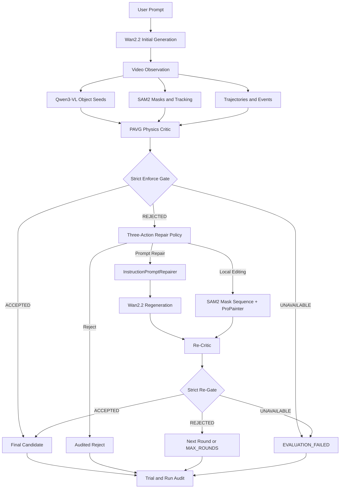

# PhysGenLoop

> Physics-aware, evidence-driven, auditable closed-loop video generation and repair.

PhysGenLoop 将视频生成从“一次生成、直接交付”改造成一个严格的闭环系统：Wan2.2 生成候选视频，PAVG Physics Critic 通过 Qwen3-VL、SAM2、轨迹、事件、规则与力学证据检查物理一致性；只有通过 Strict Acceptance Gate 的候选才会被接受。被可靠判定为不合格的候选进入 Repair Policy，经 Prompt Repair、ProPainter Local Editing 或 Reject 后重新评价。

```text
Generate → Observe → Critique → Gate → Decide → Repair
                                      ↑              ↓
                                      └── Re-Gate ← Re-Critique
                                                     ↓
                                                   Audit
```

本仓库的重点不是“永远输出一个视频”，而是保证每次接受、拒绝、修复和失败都有明确证据与可复现记录。

## 核心特性

- **真实视频生成**：Wan2.2-TI2V-5B 生成首轮候选和 Prompt Repair 候选。
- **PAVG Physics Critic**：融合视觉观测、跨帧跟踪、轨迹、事件、确定性规则、VideoScience checklist、mechanics 与 VLM 证据。
- **Strict Enforce Gate**：综合物理分数、置信度、覆盖率、语义保持和视觉质量，默认 fail closed。
- **三动作 Repair Policy**：仅保留 `prompt_repair`、`local_editing`、`reject`。
- **局部视频修复**：SAM2 mask sequence + ProPainter，禁止无 mask 的全帧 fallback。
- **修复后复评**：Executor 成功生成文件不等于修复成功；新候选必须通过 Re-Critic 与 Re-Gate。
- **完整审计**：每轮保存 CriticReport、Gate、RepairDecision、执行结果、mask manifest、Trial V3 与资源指标。
- **可恢复运行**：显式 RUN_ROOT、原子状态文件、attempt 隔离、`--resume` 和受约束的失败重试。

## 系统架构



### 三种 Gate 语义

| 状态 | 含义 | 后续行为 |
|---|---|---|
| `ACCEPTED` | 评价可用，且所有严格条件通过 | 输出候选 |
| `REJECTED` | 评价可用，但候选未达到接受条件 | 进入 Repair Policy |
| `UNAVAILABLE` | 评价链路或必需证据不可用 | 结束为 `EVALUATION_FAILED`，不执行 Repair |

`UNAVAILABLE` 与“视频不合格”严格区分。评价工具失效不会被伪装成物理违背，也不会因为“没有发现问题”而默认接受。

### 三动作 Repair

| 动作 | 适用情况 | 实现 |
|---|---|---|
| `prompt_repair` | 问题更可能来自生成约束表达不足 | `PromptRepairExecutor + InstructionPromptRepairer + WanSubprocessGenerator` |
| `local_editing` | 违背可定位到对象、帧区间和有效 mask | `MaskSequenceLocalEditingExecutor + ProPainter` |
| `reject` | 证据不足、没有安全修复目标或不应继续尝试 | `AuditedRejectExecutor` |

在线链路不包含 Global Regeneration，也不读取或写回 Memory。正式 CLI 不提供 `--force-action`；研究测试不能覆盖真实 Policy 决策。

## PAVG Physics Critic

PAVG 是 PhysGenLoop 的物理评价核心。它将不同来源的证据统一为结构化 `CriticReport`：

```text
Video
  ├─ Qwen3-VL object discovery
  ├─ SAM2 segmentation and temporal tracking
  ├─ trajectory extraction
  └─ event detection
        ↓
rules + checklist + mechanics + optional VLM evidence
        ↓
coverage-aware evidence fusion
        ↓
CriticReport
```

主要输出包括：

- `decision`：`physical`、`violation` 或 `unknown`；
- `physics_score`、`confidence`、`coverage`；
- violation 的对象、类别、起止帧、峰值帧和关键帧；
- repair instruction 与可用的 local edit target；
- rules、checklist、mechanics、VLM 等独立 evidence bundle；
- detector、SAM2、provider failure 和 degraded 状态等 diagnostics。

Critic 负责回答“观察到了什么”；Gate 负责回答“这些证据是否足以接受候选”。二者不能合并成一个模糊分数判断。

## 仓库结构

```text
PhysGenLoop-/
├── agents/wanphysics/
│   ├── run_videophy2_loop_v2.py   # 唯一正式 V2 入口
│   ├── gen_step.py                 # Wan 一次性生成子进程
│   └── eval_step.py                # Critic 一次性评价子进程
├── generators/wanphysics/
│   ├── adapter.py                  # Wan generator adapter
│   ├── sam2_vlm_critic.py          # vLLM/Qwen3-VL 生命周期
│   ├── local_editor.py             # ProPainter adapter
│   └── v2/
│       ├── runner.py               # 严格三动作状态机
│       ├── build_backends.py       # 真实后端装配
│       ├── guardrails.py           # Acceptance Gate
│       ├── policy_guard.py         # 动作能力与安全检查
│       ├── propainter_strict_editor.py
│       ├── mask_manifest.py
│       ├── trials.py               # WanRepairTrialV3
│       └── artifacts.py            # run/sample/attempt 审计产物
├── src/
│   ├── pavg_critic/                # Physics Critic
│   └── physgenloop/                # 通用契约、Repair 与 Selector
├── configs/loop_v2.yaml            # 正式严格配置
├── evaluation/manifests/           # VideoPhy2 manifests
├── schemas/                         # Critic、mask、trace、Trial schemas
├── tests/wanphysics_v2/             # V2 单元与集成测试
└── worklog/                         # 按日期归档的设计与实施记录
```

`models/`、`envs/`、`outputs/`、原始视频和模型权重不进入 Git。

## 安装

### 1. 克隆代码

```bash
git clone https://github.com/hejin001018-gif/PhysGenLoop-.git
cd PhysGenLoop-
```

### 2. 安装基础包

项目要求 Python 3.10+。仅运行 CPU 测试和 dry-run 时：

```bash
python -m venv .venv
source .venv/bin/activate
python -m pip install --upgrade pip
python -m pip install -e ".[video,env,test]"
```

真实 GPU 链路使用独立环境：

```text
envs/
├── main/          # Wan、SAM2、ProPainter、OpenCV、ffmpeg runtime
└── vllm-cu128/    # Qwen3-VL vLLM service
```

CUDA、PyTorch、vLLM 与官方 SAM2 对驱动和 CUDA 版本敏感，因此不由基础 `pyproject.toml` 强行锁定。请根据部署机器安装兼容版本，并确认：

```bash
envs/main/bin/python -c "import torch, cv2; print(torch.cuda.is_available())"
envs/vllm-cu128/bin/python -c "import vllm; print(vllm.__version__)"
```

### 3. 准备模型

默认目录结构：

```text
models/
├── wan2.2_ti2v_5b/
├── Qwen3-VL-8B-Instruct/
├── sam2-src/
├── sam2.1_hiera_base_plus.pt
└── ProPainter/
    ├── inference_propainter.py
    └── weights/
        ├── raft-things.pth
        ├── recurrent_flow_completion.pth
        └── ProPainter.pth
```

ProPainter 必须和 `sam2-src` 同层放置：

```bash
git clone https://github.com/sczhou/ProPainter.git models/ProPainter
envs/main/bin/pip install -r models/ProPainter/requirements.txt

cd models/ProPainter
../../envs/main/bin/python scripts/download_models.py
cd ../..

test -f models/ProPainter/inference_propainter.py
test -f models/ProPainter/weights/raft-things.pth
test -f models/ProPainter/weights/recurrent_flow_completion.pth
test -f models/ProPainter/weights/ProPainter.pth
```

仓库不会自动下载模型或权重，也不会在 preflight 失败时静默使用假后端。

### 4. 配置模型服务

```bash
cp .env.example .env
```

本地 vLLM 的典型配置：

```env
API_KEY=local
BASE_URL=http://127.0.0.1:8000/v1
VLM_MODEL=qwen3-vl-8b-instruct
TEXT_MODEL=qwen3-vl-8b-instruct
```

`.env` 包含部署信息，不应提交到 Git。

## 快速验证

### CPU dry-run

dry-run 验证状态机、Gate、Policy、Executor 与 Trial 契约，不加载真实模型：

```bash
PYTHONPATH=.:src \
python agents/wanphysics/run_videophy2_loop_v2.py --dry-run
```

### 测试

```bash
python -m pytest -q tests/wanphysics_v2
```

测试覆盖 Gate 三状态、Policy Guard、三动作 Executor、mask manifest、ProPainter 严格验证、Critic codec、Trial V3、artifact 和 resume 契约。

## 运行真实闭环

### Manifest

Runner 从 manifest 的 `samples` 数组读取样本。每条样本至少应有稳定的 `sample_id` 和 `prompt`：

```json
{
  "schema_version": "1.0",
  "samples": [
    {
      "sample_id": "demo-0001",
      "prompt": "A red ball falls onto a hard floor and rebounds with decreasing height."
    }
  ]
}
```

VideoPhy2 manifest 中的 benchmark 标签和原视频路径用于数据溯源；正式生成闭环仍由 Wan 根据 prompt 生成首轮候选。

### 单样本 smoke

```bash
cd /path/to/PhysGenLoop- || exit 1

RUN_ROOT="$PWD/outputs/v2_smoke_strict"
LOG="$RUN_ROOT/physgenloop.log"
STATUS="$RUN_ROOT/exit.status"
PIDFILE="$RUN_ROOT/process.pid"

if [ -e "$RUN_ROOT/run_manifest.json" ]; then
  echo "refusing to overwrite initialized run: $RUN_ROOT" >&2
  exit 2
fi
mkdir -p "$RUN_ROOT"

nohup bash -c '
cd "$1" || exit 1

PYTHONPATH="$1:$1/src" \
envs/main/bin/python agents/wanphysics/run_videophy2_loop_v2.py \
  --enable \
  --manifest evaluation/manifests/videophy2_smoke_dev10.json \
  --limit 1 \
  --max-rounds 2 \
  --output-root "$2"

status=$?
printf "%s\n" "$status" > "$3"
exit "$status"
' _ "$PWD" "$RUN_ROOT" "$STATUS" > "$LOG" 2>&1 &

PID=$!
printf "%s\n" "$PID" > "$PIDFILE"
printf "pid=%s\nlog=%s\nrun_root=%s\n" "$PID" "$LOG" "$RUN_ROOT"
```

`--output-root` 指定的路径就是最终 RUN_ROOT，Runner 不会在其内部再创建随机时间戳目录。

### 前台运行

调试时也可以直接运行：

```bash
PYTHONPATH=.:src \
envs/main/bin/python agents/wanphysics/run_videophy2_loop_v2.py \
  --enable \
  --manifest evaluation/manifests/videophy2_smoke_dev10.json \
  --limit 1 \
  --max-rounds 2 \
  --output-root outputs/v2_smoke_foreground
```

### Resume

使用与原 run 完全一致的配置、manifest 和关键参数，并增加：

```text
--resume
```

仅当需要重新尝试可重试的失败样本时使用：

```text
--resume --retry-failed
```

Resume 会校验 manifest hash、配置 hash、样本集合和运行参数；不兼容时 fail fast，避免把不同实验混进同一 RUN_ROOT。

## 运行产物

```text
RUN_ROOT/
├── run_manifest.json
├── run_status.json
├── summary.json
├── vllm.log
├── vllm.owner.json
└── <sample_id>/
    ├── sample_status.json
    ├── sample_status_history.jsonl
    ├── active_attempt.json
    └── attempts/attempt_0001/
        ├── loop_result.json
        ├── repair_trace.jsonl
        ├── trials.jsonl
        ├── resource_metrics.jsonl
        └── <candidate_id>/
            ├── metadata.json
            ├── prompt.txt
            ├── critic_report.json
            ├── repair_decision.json
            ├── mask_manifest.json
            ├── sam2_masks/
            └── <candidate_id>-v01.mp4
```

### 样本终态

| 终态 | 含义 |
|---|---|
| `ACCEPTED` | 当前候选通过 Strict Gate |
| `REJECTED` | Policy 选择审计式停止 |
| `MAX_ROUNDS` | 达到最大修复轮数，未获得可接受候选 |
| `EVALUATION_FAILED` | Critic/Gate 所需评价不可用 |
| `EXECUTION_FAILED` | 生成或修复执行失败 |
| `PREFLIGHT_FAILED` | 模型、环境、端口或依赖未就绪 |

Run 可能以 `COMPLETED_WITH_REJECTIONS` 正常结束。`REJECTED` 和 `MAX_ROUNDS` 是业务结果，不等同于程序崩溃；只有评价、执行或 preflight 失败会使入口返回非零状态。

## 严格不变量

1. 只有 `REJECTED` 可以进入 Repair Policy；`UNAVAILABLE` 不得伪装成视频不合格。
2. Gate 必须使用 `enforce`；在线运行不支持 shadow acceptance。
3. Policy 每轮只决策一次，CLI 不得强制动作。
4. Local Editing 必须具有通过校验的 mask sequence，不允许全帧 fallback。
5. 修复后必须使用同一套 Critic 和 Gate 重新评价。
6. `after_candidate`、`critic_after` 和分数增益只能来自真实执行，不得由 proxy 数据补齐。
7. Reject 终止时保留最佳已观测候选，但不将其标记为 accepted。
8. vLLM 只管理本 run 拥有的 PID，不得宽泛终止其他进程。

## 当前验证状态

项目已完成以下工程路径的真实联通验证：

- Wan2.2 视频生成；
- Qwen3-VL/vLLM 启动、调用与释放；
- SAM2 多帧跟踪、mask 输出和 CUDA extension；
- PAVG Critic 完整报告；
- Strict Gate、自然 Policy 决策和 Audited Reject；
- ProPainter Local Editing、Re-Critic 与 Re-Gate；
- Trial V3、repair trace、资源指标和 run 级审计。

这些验证证明“链路可以真实执行”，不等于已经证明“修复总能提高物理一致性”。在已审计案例中，ProPainter 可以成功生成修复候选，但 Re-Critic 可能仍报告相同违背；此时系统应保持 `REJECTED` 或 `MAX_ROUNDS`，而不是把文件生成成功包装成物理修复成功。

## 已知限制

- 当前 Repair Policy 是三动作 heuristic，不是已训练完成并通过 benchmark 的学习型策略。
- Memory 已从在线主链路退役；代码中的兼容模块不代表 runtime 会使用 Memory。
- PhysicsPlan 不进入 WanPhysics V2 在线主链路；`pavg_critic` 中的历史 planner 代码仅用于兼容和离线研究。
- ProPainter 擅长局部视觉补全，不保证修正全局动力学或长时轨迹。
- 外部视频在进入 ProPainter 前应统一到兼容的编码和尺寸；非 16 对齐尺寸可能被编码器自动改变。
- 图像坐标中的速度与力学指标主要用于相对一致性判断；真实尺度需要相机标定、深度或真值轨迹。
- Strict Gate 的阈值需要在独立验证集上校准，不能仅凭小样本结果宣称论文级性能。
- 当前系统是单机同步研究流水线，不包含生产级队列、服务编排或分布式调度。

## 配置说明

正式配置为 [`configs/loop_v2.yaml`](configs/loop_v2.yaml)。常用字段：

| 配置 | 作用 |
|---|---|
| `runtime.gpu_mode` | 双卡或单卡资源交接模式 |
| `acceptance.*` | Strict Gate 阈值和无退化约束 |
| `local_editing.enabled` | 是否开放 ProPainter capability |
| `policy.minimum_coverage` | Policy 所需最低证据覆盖率 |
| `loop.max_rounds` | 最大修复轮数 |
| `vllm.gpu_memory_utilization` | vLLM 显存比例 |

增加 `max_rounds` 只会提供更多修复机会，不保证改善结果，也会线性增加生成、编辑和复评成本。应结合 `trials.jsonl` 中的实际增益决定是否扩大轮数。

## 开发约定

- 正式在线入口只有 `agents/wanphysics/run_videophy2_loop_v2.py`。
- `run_actual_trials_v2.py` 是退役的研究入口，不用于正式运行。
- 接口契约以 `schemas/`、`src/physgenloop/contracts.py`、`src/physgenloop/learning_repair/contracts.py` 和 `generators/wanphysics/v2/trials.py` 为准。
- 新功能应接入现有 Runner、Gate、Policy、Executor 和 Artifact 边界，不新增平行主链路。
- 不提交模型、权重、视频、输出目录、虚拟环境、密钥和机器绝对路径。
- 设计与验证记录写入 `worklog/YYYY_MM_DD/`；稳定使用说明更新到本 README。

提交前建议执行：

```bash
git diff --check
python -m pytest -q tests/wanphysics_v2
python -m compileall -q src generators agents
```

## 研究目标

PhysGenLoop 关注的核心问题是：

> 能否让视频生成系统不仅产生视觉上合理的结果，还能发现物理违背、选择合适的干预方式，并用同一套证据标准验证修复是否真实有效？

项目希望提供一个可复现的研究基座，用于比较 direct generation、prompt repair、local editing、不同 Physics Critic、不同 Gate 阈值和不同 Repair Policy，而不是通过隐藏失败或降低门槛制造成功样本。

## Acknowledgements

PhysGenLoop 的真实链路建立在 Wan2.2、Qwen3-VL、SAM2、ProPainter、vLLM、PyTorch、OpenCV 和 ffmpeg 等开源项目之上。使用模型、代码和权重时，请分别遵守其原始许可证与使用条款。

## License and citation

当前仓库尚未提供统一的根目录许可证或正式论文引用信息。在公开再分发、商业使用或引用前，请先确认仓库后续发布的 `LICENSE` 与 citation 文件，并同时遵守各第三方模型和组件的许可证。
